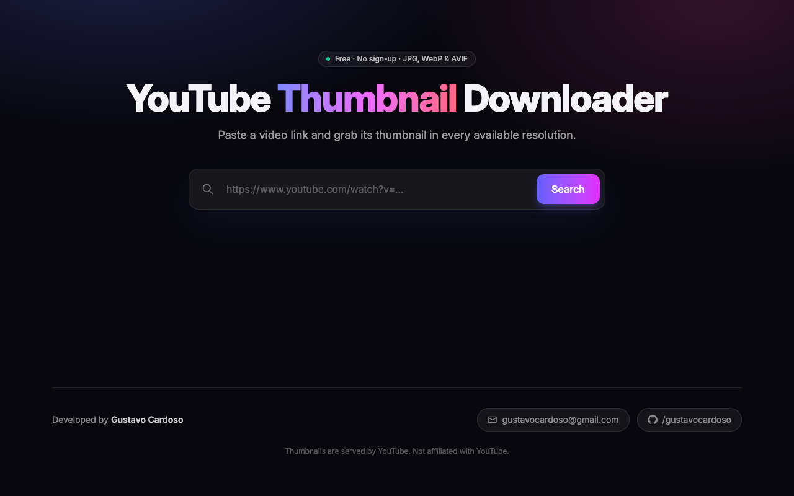
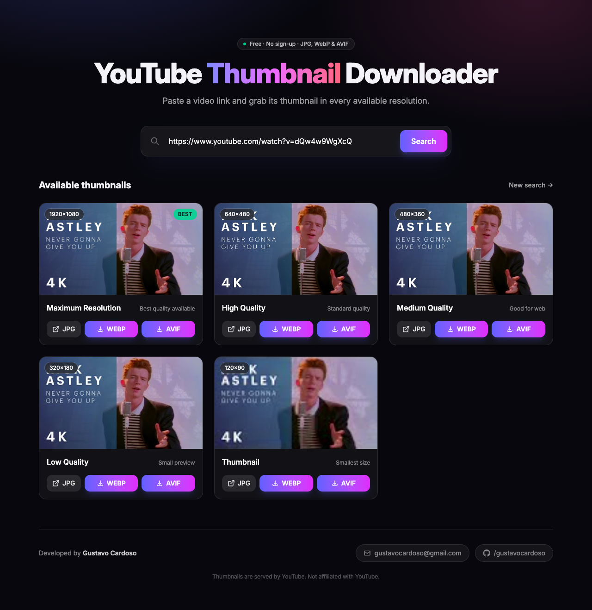
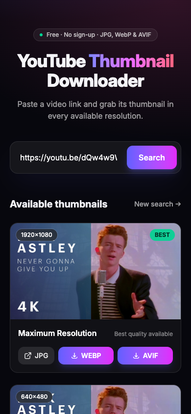

# YouTube Thumbnail Downloader

Paste a YouTube video link and download its thumbnail in every available resolution, as **JPG**, **WebP** or **AVIF**. No login, no sign-up.

Built with **React Router v7** (framework mode, successor of Remix), **TypeScript**, **Tailwind CSS v4** and **sharp**, ready to deploy on **Vercel**.



## Features

- Accepts several link formats: `youtube.com/watch?v=`, `youtu.be/`, `youtube.com/embed/`, `youtube.com/v/`, or the bare 11-character video ID.
- Shows 5 resolutions: 1920×1080, 640×480, 480×360, 320×180 and 120×90.
- Download the original JPG from YouTube, or convert to WebP/AVIF on the server (quality 85).
- Sizes that don't exist for a video (common for `maxres`) are shown as "Not available".
- The search lives in the URL (`/?url=...`), so results can be shared.
- Responsive layout, dark theme.



## How to use

1. Open the app.
2. Paste the video link into the search field and click **Search** (or press Enter).
3. Pick the resolution you want:
   - **JPG**: opens the original image in a new tab (right-click to save).
   - **WEBP** / **AVIF**: converts and downloads the file directly.
4. Click **New search** to start over.

Accepted input examples:

```
https://www.youtube.com/watch?v=dQw4w9WgXcQ
https://youtu.be/dQw4w9WgXcQ
https://www.youtube.com/embed/dQw4w9WgXcQ
dQw4w9WgXcQ
```

<p align="center">
  
</p>

## Running locally

Requirements: Node.js 20+ and npm.

```bash
git clone https://github.com/gustavocardoso/youtube-thumbnail.git
cd youtube-thumbnail
npm install
npm run dev
```

Open http://localhost:5173.

### Scripts

| Command             | Description                                  |
| ------------------- | -------------------------------------------- |
| `npm run dev`       | Development server with HMR                  |
| `npm run build`     | Production build                             |
| `npm start`         | Serves the build (`react-router-serve`)      |
| `npm test`          | Unit tests (Vitest)                          |
| `npm run typecheck` | Generates route types and runs `tsc`         |

## Conversion API

`GET /api/convert`

| Parameter | Required | Values                                              | Default  |
| --------- | -------- | --------------------------------------------------- | -------- |
| `v`       | yes      | Video ID (11 characters)                            | -        |
| `q`       | no       | `maxres`, `standard`, `high`, `medium`, `default`   | `maxres` |
| `format`  | no       | `avif`, `webp`                                      | `avif`   |

```bash
curl -o thumb.avif "http://localhost:5173/api/convert?v=dQw4w9WgXcQ&q=high&format=avif"
```

Error responses (JSON `{ "error": "..." }`): `400` for invalid parameters or an image that doesn't exist on YouTube, `500` if the conversion fails.

The endpoint only accepts a video ID and builds the `img.youtube.com` URL on the server, so it can't be used as an open proxy.

## Deploying to Vercel

1. Push the repository to GitHub.
2. In Vercel, click **Add New → Project** and import the repository.
3. The React Router preset is detected automatically. No environment variables are needed.
4. Click **Deploy**.

The `sharp` conversion runs on Vercel Functions (Node.js runtime).

## Project structure

```
app/
├── lib/
│   ├── youtube.ts          # video ID extraction and thumbnail URLs
│   └── youtube.test.ts     # tests
├── routes/
│   ├── home.tsx            # main page (search + cards)
│   └── api.convert.ts      # WebP/AVIF conversion
├── routes.ts               # route definitions
├── root.tsx                # root layout
└── app.css                 # Tailwind + theme
```

## Author

Developed by **Gustavo Cardoso**  
[gustavocardoso@gmail.com](mailto:gustavocardoso@gmail.com) · [github.com/gustavocardoso](https://github.com/gustavocardoso)

Thumbnails belong to their respective creators and are served by YouTube. This project is not affiliated with YouTube.
